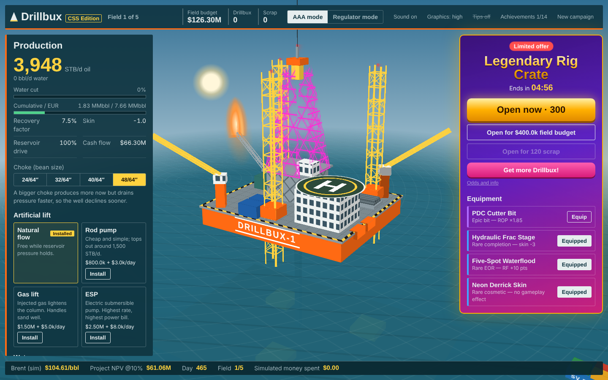
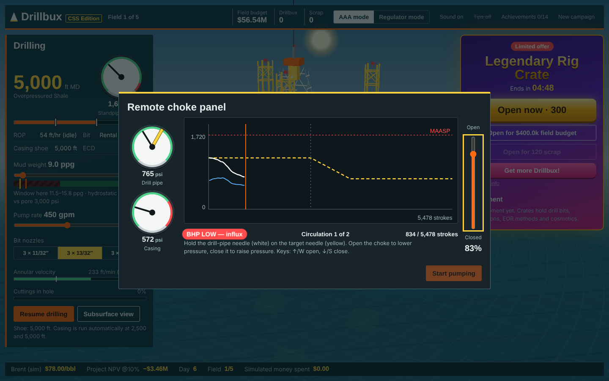
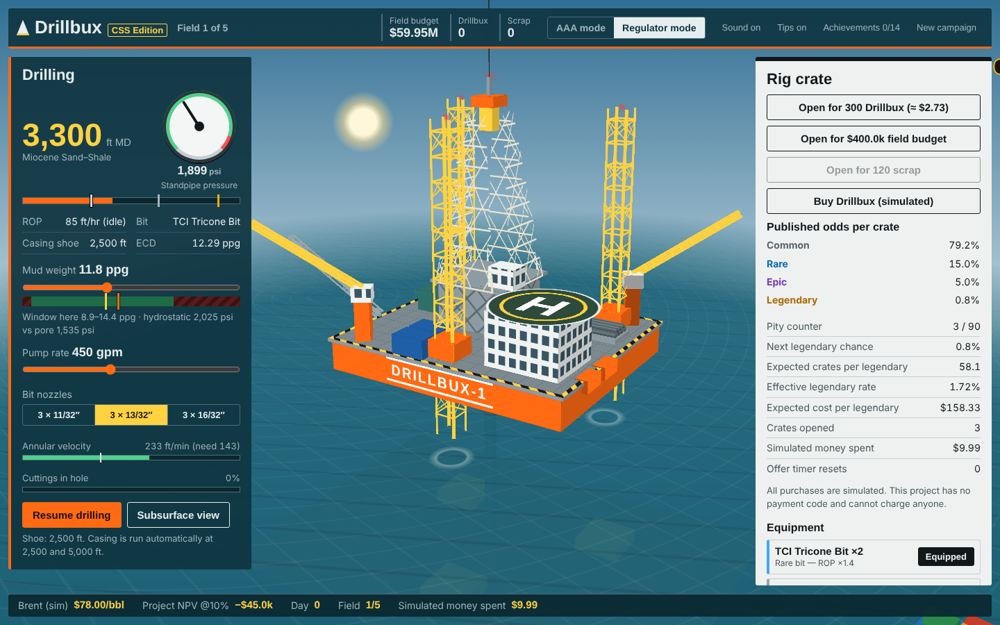
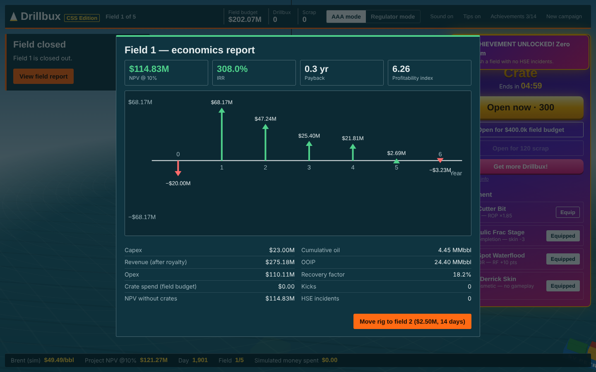

# Drillbux — CSS Edition

**A satirical AAA microtransaction simulator built on real petroleum engineering, with an offshore rig drawn entirely in CSS.**

Drill five offshore fields, kill kicks on a live choke panel using your own IWCF kill sheet, make production decisions, handle HSE calls and storms, and close each field with a full engineering-economics report. Meanwhile the crate store tries to take your money, until you flip to Regulator mode and see how it works.

## [▶ Play in your browser](https://kendrewflor.github.io/drillbux-css/)



## What's new compared with the original Drillbux

| | Drillbux (v1) | CSS Edition |
|---|---|---|
| 3D rig | Three.js / WebGL | **Pure CSS 3D transforms**: no canvas, no WebGL, no images |
| Third-party code | Three.js (vendored) | **None at all** |
| Well control | One-click kill | **Kill sheet + live choke mini-game**, Driller's or Wait & Weight |
| Drilling | Mud weight only | **Hydraulics**: ECD, pump rate, nozzles, hole cleaning, casing points, stuck pipe |
| Production | Watch numbers | **Choke size, artificial lift, water breakthrough & handling** |
| Economics | Running NPV | **Per-field report**: cash flow diagram, NPV, IRR, payback, PI |
| Goal | Sandbox | **Five-field campaign** with a score and best score |
| Events | Kicks, losses | **HSE stop-work calls, storms, spills with bioremediation** |
| Also new | — | Tutorial tips, synthesised sound, day/night cycle, weather, 14 achievements, New campaign button |

## How to play

1. **Drill.** Set mud weight, pump rate and bit nozzles, then spud.
   - The yellow needle is static mud weight and the orange one is ECD. Keep both inside the green window.
   - Pump fast enough to clean the hole, but not so fast that ECD fractures the formation or the pumps hit their pressure limit.
   - Casing is set automatically at 2,500 and 5,000 ft.
2. **Survive the kick.** Overpressured shale starts at 5,000 ft. If your mud is too light, the well kicks:
   1. Identify the influx from SIDPP, SICP and pit gain.
   2. Pick a kill method.
   3. Fill in the kill sheet (KMW, ICP, FCP).
   4. Work the choke to hold drill-pipe pressure on your schedule while watching casing pressure against MAASP.
   
   Or hand over to the company man, which is slower and more expensive.
3. **Complete.** Review the reservoir. The forecast tells you whether the well is deliverability-limited (stimulation helps) or reserves-limited (EOR helps).
4. **Produce.**
   - Choose a choke size: bigger means more oil now and a faster decline.
   - Install artificial lift when natural flow fades.
   - Decide what to do when water breaks through.
5. **Abandon.** Plug the well and read the economics report.
6. **Repeat for five fields.** Your score is total project NPV at 10%.



**Controls:** drag to orbit, scroll or pinch to zoom. The 3D view is also keyboard-focusable: arrow keys rotate, + and − zoom. On the choke panel, ↑/W opens the choke and ↓/S closes it.

## The two store modes

| AAA mode | Regulator mode |
|---|---|
| Odds hidden behind a faint link | Published odds and live pity counter |
| A "limited offer" countdown | The same countdown, with how many times it has silently reset |
| Prices in Drillbux only | Every price converted to dollars, plus expected cost per legendary |
| A legendary flashes before every miss | An explanation of why that "near miss" was never possible |
| Bundles that strand leftover currency | The cheapest bundle combination and exactly how much is stranded |
| Fanfare on every crate | Fast, quiet results |

The field report also shows how much NPV your crate spending cost.



**All purchases are simulated.** There is no payment code anywhere in this repository.

## The engineering

| Area | Models |
|---|---|
| Pressure & well control | Hydrostatic pressure, pore/fracture window, MAASP, KMW, ICP, FCP, influx gradient, strokes to bit and bottoms-up |
| Hydraulics | Annular velocity, power-law pressure losses, ECD, bit pressure drop, HSI, standpipe pressure, hole-cleaning threshold |
| Reservoir | Volumetric OOIP, pseudo-steady-state radial Darcy inflow with skin, Arps decline, reserves-limited rate |
| Production | Choke trade-off, natural-flow decline, artificial lift, water cut after breakthrough |
| Economics | Mean-reverting oil price, royalty, opex, NPV, IRR, payback, profitability index, cash flow diagram |



Equations, assumptions and parameter ranges are in [docs/PETROLEUM_MODEL.md](docs/PETROLEUM_MODEL.md). Every model is a pure function with a test against a hand calculation.

## Run it locally

No install step. Node 20+ is needed only for the dev server and checks.

```sh
npm start        # http://127.0.0.1:5173
npm test         # 41 tests: physics, well control, economics, game flow, save validation
npm run check    # security scan + tests
```

## Security

- **Zero third-party code:** no dependencies, no vendored libraries, no CDN, no install scripts.
- **Strict CSP:** same-origin scripts and styles only, no network access, no inline code.
- **SHA-pinned GitHub Actions** with read-only tokens, plus CodeQL.
- **Prompt-injection scanning** in CI: hidden Unicode, agent config files, hidden Markdown comments and injection phrases fail the build.
- **Untrusted save data:** local storage is schema-validated; reservoirs, rates and crate rolls are re-derived from the seed, never trusted.

Details: [SECURITY.md](SECURITY.md) and [docs/THREAT_MODEL.md](docs/THREAT_MODEL.md). Using AI coding tools on this repo? Read [docs/AI_TOOLING.md](docs/AI_TOOLING.md) first.

## Project layout

```
index.html           entry point and CSP
src/
  rig.js, rig.css    the pure-CSS 3D rig, ocean, weather, day/night, cutaway
  reservoir.js       pressure, hydraulics, well control, reservoir, production (pure)
  wellcontrol.js     kill-sheet checking and the choke simulator (pure)
  finance.js         NPV, IRR, payback, PI, field ledger (pure)
  events.js          HSE, weather and spill events
  economy.js         crate odds, pity, bundles (pure)
  game.js            game state, simulation tick, campaign, save validation
  main.js, style.css UI
  charts.js          SVG cash flow diagram and pressure chart, CSS dial gauges
  audio.js           synthesised sound (WebAudio, no files)
  dom.js, rng.js     injection-safe DOM builder, seeded PRNG
scripts/             dev server, security scanner
tests/               node:test suites
```

## License

MIT © 2026 Kendrew Flor S. Arrabe
